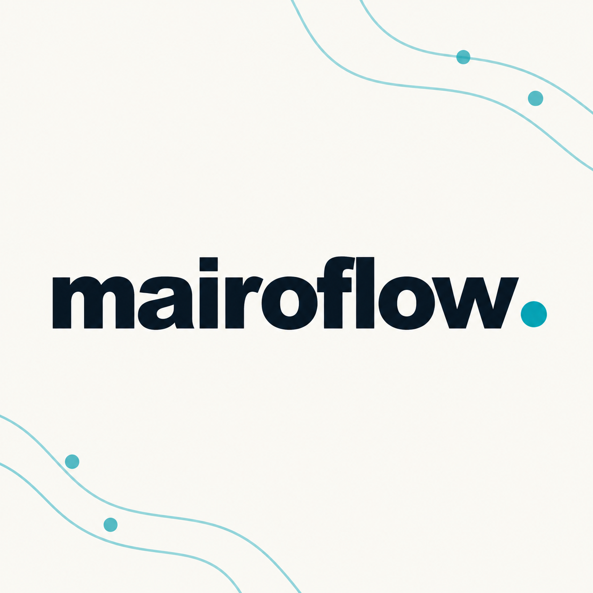

# Felix Mairamhof

**Full-Stack Developer · AI & Automation Engineer · Founder of [Mairoflow](https://mairoflow.com)**

I build modern web applications, custom software and intelligent automations — from the first idea to reliable production deployment.

📍 Klagenfurt, Austria &nbsp;·&nbsp; **3+ years of experience** &nbsp;·&nbsp; **10+ projects delivered**

---

## 👋 About me

I'm an Austrian software developer and the founder of **Mairoflow**, where I help businesses build better digital experiences and reduce manual work through software, automation and AI.

My background spans **full-stack development, backend engineering, cloud infrastructure and DevOps**. I enjoy owning the full process: understanding a problem, designing a practical solution, building it and keeping it running in production.

I'm interested in both **challenging engineering opportunities** and **collaborations with businesses that want to turn ideas into working products**.

## 🛠️ Tech stack

| Area | Technologies |
| --- | --- |
| **Frontend** | Next.js, React, TypeScript, JavaScript, Tailwind CSS |
| **Backend** | C#, ASP.NET Core / Web API, Node.js, Python, Java, REST APIs |
| **Data** | PostgreSQL, Redis, SQL |
| **Cloud & DevOps** | Docker, Kubernetes, GitHub Actions, Azure, Hetzner, Cloudflare, CI/CD |
| **AI & Automation** | AI integrations, agentic workflows, n8n, business process automation |

## 🚀 Selected work

| Focus | What I've built |
| --- | --- |
| **Websites & web applications** | Modern customer-facing websites, authenticated dashboards, internal tools and full-stack applications |
| **IoT & data platforms** | Sensor onboarding workflows, beacon management dashboards and applications for processing sensor data |
| **AI & automation** | Automated business workflows, API integrations and AI-assisted processes |
| **Infrastructure & operations** | Secure deployments, containerized services, monitoring, hosting and ongoing maintenance |

Some customer projects are private or proprietary. Public examples and case studies are available on the **[Mairoflow portfolio →](https://mairoflow.com/referenzen)**.

## 💼 Experience

**Founder & Developer · [Mairoflow](https://mairoflow.com)**  
*June 2026 – Present*

Building websites, individual software solutions and AI automations for businesses — including deployment, hosting and ongoing support.

**Software Developer · Comm-Unity EDV GmbH**  
*August 2024 – September 2026 · Part-time alongside my technical education*

Worked on C# / ASP.NET Web APIs, web applications, agentic engineering and deployment infrastructure using Kubernetes.

**Java Development Intern · UNiQUARE Software Development GmbH**  
*July 2024*

Worked on features in legacy banking software using Java, as well as DevOps and deployment improvements.

## 🎓 Education & certifications

**HTL Mössingerstraße, Klagenfurt · 2021–2026**  
Electronics & Technical Computer Science · Focus on software engineering, AI and IoT  
Diploma project: **Reliable IoT Window Control**

<table>
<tr>
<td width="50%" valign="top">

**CS50x · Introduction to Computer Science**  
<a href="https://github.com/FelixMairamhof/FelixMairamhof/files/15178377/CS50x.pdf">View certificate ↗</a>
</td>
<td width="50%" valign="top">

**Claude Academy**  
Coursework in AI and working with Claude.
</td>
</tr>
<tr>
<td valign="top">

**Apply AI at Work**  
Practical AI applications and workflows.
</td>
<td valign="top">

**Complete Web Developer Bootcamp**  
<a href="https://github.com/FelixMairamhof/FelixMairamhof/files/15178388/WebDevCourse.pdf">View certificate ↗</a>
</td>
</tr>
</table>

## 🏆 Awards & hackathons

| Year | Recognition | Project |
| --- | --- | --- |
| **2026** | **Top 10 finalist — innovation@school** (65+ entries) | *Reliable IoT Window Control*, diploma project awarded €2,000 in project funding. [Read more →](https://www.htl-klu.at/details?cHash=2b53858b8884a2f8219069026f7348d4&tx_news_pi1%5Bnews%5D=457&tx_news_pi1%5BoverwriteDemand%5D%5Bcategories%5D=9) |
| **2025** | **2nd place — Kelag IT Hackathon** | *EnergyAttack*, a full-stack solution built with frontend, backend and Microsoft Azure. [Read more →](https://www.htl-klu.at/details?cHash=d9e0ad1b8004ac10e0305eae514f296a&tx_news_pi1%5Bnews%5D=349&tx_news_pi1%5BoverwriteDemand%5D%5Bcategories%5D=10) |
| **2024** | **2nd place — Kelag IT Hackathon** | *EnergyAttack*, an AI-powered .NET application to classify, prioritize and assign IT support tickets. [Read more →](https://www.htl-klu.at/details?tx_news_pi1%5Bnews%5D=256&cHash=01c0e25fba8f68a5f01c0fa438a0a2f8) |

## 🤝 Let's build something useful

Looking for someone who can handle both **software engineering and real-world delivery**?

Whether you're recruiting for a technical role, exploring a collaboration or need a reliable partner for a business project, feel free to reach out.

**[🌐 Mairoflow](https://mairoflow.com)** · **[💼 LinkedIn](https://www.linkedin.com/in/felix-mairamhof-9b7ba4325)** · **[✉️ Email](mailto:kontakt@mairoflow.com)**

